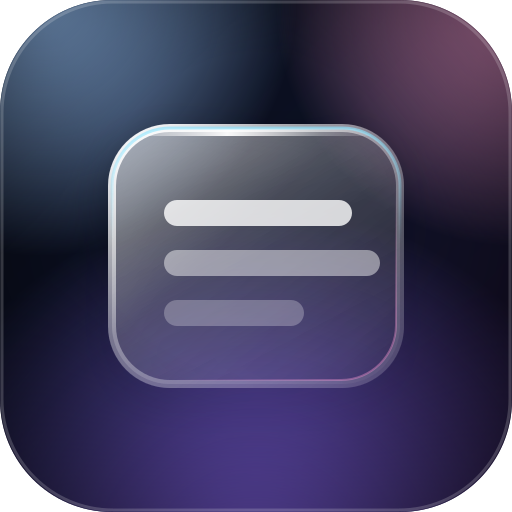
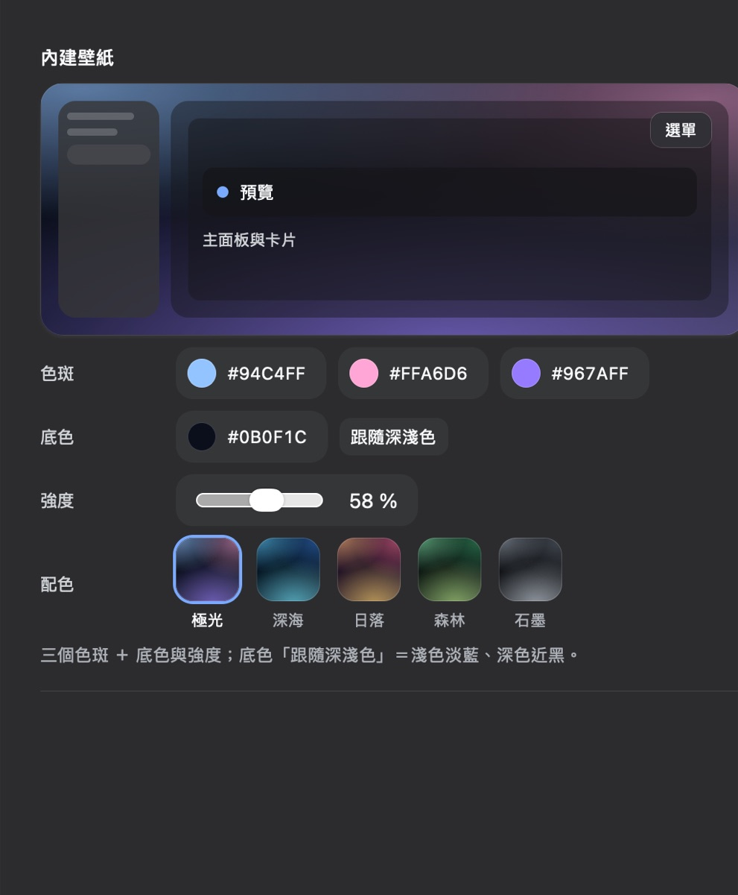

# dsh-appearance-glass

DSH 外觀插件：**介面透明度**（四個分區獨立可調）＋ **內建壁紙顏色**。
純粹的 alpha，**沒有任何模糊、飽和或高光** —— 1.1 起移除「模式」與液態玻璃。



| | |
| --- | --- |
| 設定位置 | **設定 → 介面外觀**（`settings.section`，排在「通用設定」之後、「模型」之前） |
| 同一份面板 | **設定 → 外掛 → dsh-appearance-glass** 卡片頁（`plugins.bundle.config`） |
| 寫到哪 | profile 的 `cordis.patch.yml`（`config:` 段），**改完立即生效、不需重啟** |
| 不影響 | DSH 任何原始碼；卸載後整層效果完全撤除 |

## 1.1 的變更（為什麼拿掉模式）

| 之前 | 現在 |
| --- | --- |
| 三種模式：原生／透明／液態玻璃 | **只剩透明**（沒有模式可選；效果永遠是透明） |
| 液態玻璃：backdrop blur、飽和、斜向高光、邊緣內描邊、遮罩模糊 | **全部移除**（外掛不再自己加任何 `backdrop-filter`） |
| `mode` / `blur` / `saturate` 三個欄位 | 移除；改為 **`enabled`** 總開關（想 A/B 對比時不用卸載） |
| 「原生」模式當退路 | 標題列的「啟用」開關當退路 |

> 舊設定檔若還留著 `mode: clear`、`blur: 34` 之類的鍵，**不會壞掉** ——
> schemastery 對未知鍵是放行的（`test/host.test.mjs` 有專門驗這一條）。

## 設定頁長什麼樣

由上而下：

1. **標題列** —— 標題、`本 profile 已自訂` 徽章、寫入狀態、**啟用**（官方 `Switch`）、**恢復預設**
2. **介面不透明度** —— 四根滑桿（主畫面／側欄／卡片與輸入框／選單與浮層）＋ **同步** 小按鈕
   （把「主畫面」的值一次套到其他三項）
3. **透視背景** —— 自動／內建壁紙／純透明
4. **內建壁紙** —— **即時預覽**（側欄＋主面板＋卡片＋浮動選單）＋ 四列對齊的控制項：
   **色斑**（三顆顏色 pill）／**底色**（顏色 pill ＋ 跟隨深淺色）／**強度**（滑桿 pill）／
   **配色**（五張 44px 漸層卡：極光／深海／日落／森林／石墨，命中時外圍一圈 focus 藍）



預覽的每個 mock 表面**直接吃官方 token**，而且**疊層數與真實介面一致**
（主畫面 2 層、側欄 2 層、卡片 1 層、浮層 1 層），所以預覽看到的就是滑桿的合成結果。

壁紙區的四列都用 `.dsg-line`（標籤固定在 84px 欄），左緣與上面四根不透明度滑桿**完全對齊**；
顏色控制是「色點 ＋ hex」的 pill，原生 `<input type="color">` 透明鋪滿整顆 pill，
所以點哪裡都會開系統色盤，外觀卻是自己的（原生色票在各平台長相差很多）。

配色卡的圈只會在**真的命中**某一組時出現（逐欄位比對）；出廠值是 `auto`（跟隨深淺色），
它不等於任何一組固定預設，所以剛裝好時五張卡都不會被圈起來。

## 參數

| 欄位 | 範圍 | 預設 | 說明 |
| --- | --- | --- | --- |
| `enabled` | 布林 | `true` | 總開關；`false` 時完全不動任何 token |
| `opacityBase` | 0–100 % | 68 | 主畫面（對話區底色；實際疊 2 層，見下節） |
| `opacitySidebar` | 0–100 % | 68 | 側欄與其選取態（官方在欄上另加一層 40% 底色） |
| `opacitySurface` | 0–100 % | 68 | 卡片、輸入框、訊息泡泡、程式碼區塊 |
| `opacityOverlay` | 0–100 % | 72 | 選單、tooltip、toast、浮層 |
| `backdrop` | `auto` / `wallpaper` / `none` | `auto` | `auto`＝桌面版用原生視窗材質、其他環境鋪壁紙 |
| `wallpaperA/B/C` | `#rrggbb` 或 `auto` | `auto` | 三顆色斑；`auto`＝出廠配色且跟隨深淺色 |
| `wallpaperBase` | `#rrggbb` 或 `auto` | `auto` | 底色；`auto`＝淺色 `#e9f0ff`／深色 `#0b0f1c` |
| `wallpaperStrength` | 10–100 | 58 | 色斑強度（第二、三顆自動比第一顆弱） |

## 滑桿上的數字是「合成後」的透明度（層數補償）

介面上同一塊底色常被疊了好幾層，例如 darwin 下官方 CSS 讓 `.centerCol` 與對話區 root
**各畫一次** `--dsw-alias-bg-base`。若直接把 token 設成 68%，實際看到的是
`1-(1-0.68)² = 89.8%` —— 這就是「調到最低還是看不透」的原因。

所以外掛用真實層數反推單層值（`a = 1-(1-target)^(1/depth)`）：

| 分區 | 真實疊層 | 滑桿 20% 時寫入 | 實際合成 |
| --- | --- | --- | --- |
| 主畫面 | 2 | 11% | 20.0% |
| 側欄 | ~1.4 | 13% | ~20% |
| 卡片／輸入框 | 1 | 20% | 20.0% |
| 選單／浮層 | 1 | 20% | 20.0% |

同區內的相對加權（delta）也跟著目標值等比縮小，低透明度時不會被拉回去。

## 為什麼在 macOS 桌面版是「真的透視」

DSH 桌面版主視窗以 `vibrancy: 'sidebar'` + `backgroundColor: '#00000000'` 建立，
官方 CSS 在 `html[data-platform=darwin]` 下把 html/body 背景設成 transparent。
**桌面材質一直都在，只是被各面板的不透明背景蓋住**；本外掛把那些表面的 token 換成半透明色，
原生材質就透出來 —— 不是 CSS 假裝的。

> ⚠️ 系統視窗材質本身的模糊**關不掉**：那是 Electron 主行程的視窗屬性
> （`lib/main.js` 的 `vibrancy` + `visualEffectState`），renderer 端沒有任何 IPC 能改
> （已核對 preload 暴露的 `DESKTOP_IPC`：`nativeThemeSet` 只切深淺色、
> `windowsAppearance` 只給 Windows 標題列上色）。想要真正零模糊，請用瀏覽器開 DSH。

## 實作方式（給要改它的人）

* 主要手段是 **theme token 覆寫**（`ctx.theme.overrideTokens`）：官方元件自己消費 `--dsw-*`
  token，所以覆寫會沿用到所有面板，不依賴任何 hash 過的 class 名。
* **只有壁紙**會碰 `<html>`（`background-image`）。外掛不對任何容器加 `backdrop-filter`
  —— 容器一旦有它就會變成 fixed 子孫的 containing block，而 DSH 的選單用
  CSS anchor positioning + `position:fixed` 就地渲染，會有定位風險。
* UI 全部由官方元件組成：形狀逐字抄官方 module.css（selector pill 36px、
  `--dsw-radius-md`、`--dsw-alias-bg-module-platform`），選單用官方 `Menu`、
  開關用官方 `Switch`；取不到時退化成同形狀的原生 `<select>`／文字按鈕（fail-open）。
* **一列一個控制項**：內容欄在窄視窗只有約 490px，控制項與文字爭寬會把說明壓成「一字一行」。
* 全部 fail-open：找不到 theme/slots/configForms 就不註冊、什麼都不改。

## 安裝

```sh
# 從 npm 安裝（推薦；設定 → 外掛 → 已安裝 會看到它）
dsh plugin --profile web add dsh-appearance-glass

# 或直接從 GitHub 裝（未來的版本、還沒發佈的 commit）
dsh plugin --profile web add github:david0304git/dsh-appearance-glass
```

裝好後開 **設定 → 介面外觀**；Host 半的 Config 若剛好有改動，第一次需要重啟 DSH，
之後調整都即時生效（瀏覽器半另有熱重載）。

**需求**：`dsh >= 0.2.0`（`package.json` 的 `engines.dsh`），實測版本 0.2.1-rc.2。
唯一的 peer 依賴是 `@deepseek-ai/schemastery`（由宿主提供，`optional`），不需要你另外安裝。

### 在插件市場上找得到嗎

- **官方 Discover**：`plugin_market` 讀的是**你自己加的索引 URL**（DSH 預設不加任何索引）。
  兩個現成的可以直接貼：
  - `https://cdn.jsdelivr.net/npm/dsh-plugin-catalog/index.json` ← awesome-dsh-plugin 那份清單
  - `https://awesome-dsh-plugin.com/index.json`
- **dsh-market**（`dshmarket` 外掛）：只安裝 `awesome-dsh-plugin` 清單裡的外掛，
  所以本外掛要先被收錄才會出現在那裡。

### 用 CLI 改設定（不想開 GUI 時）

```yaml
# ~/.dsh/profiles/desktop/cordis.patch.yml
- id: appearance-glass
  name: dsh-appearance-glass
  config:
    enabled: true
    opacityBase: 40
    opacitySidebar: 55
    opacitySurface: 60
    opacityOverlay: 72
    backdrop: wallpaper
    wallpaperA: "#94c4ff"
    wallpaperB: "#ffa6d6"
    wallpaperC: "#967aff"
    wallpaperBase: "auto"
    wallpaperStrength: 58
```

> 改完請重啟 DSH（設定檔在開機時讀）。GUI 內改則立即生效。

## 測試

```bash
npm test          # = node test/run.mjs：host 6 + client 29 + token 4
```

`test/tokens.test.mjs` 會**讀目前安裝的 DSH 版本**（從 `app.asar` 解出官方 CSS），
把外掛覆寫的每個 token 與 `--dsw-static-*` 色票逐一核對 —— DSH 升級後 token 改名會立刻被抓到。
（實際跑過：DSH 0.2.1-rc.2，403 個官方 token。）

## 疑難排解

| 症狀 | 原因與處理 |
| --- | --- |
| 反白的控制項 | 該欄位還沒被宿主服務（通常是改了 Host 半但沒重啟）。標題列會說明要重啟 |
| 完全沒變化 | 看標題列的「啟用」是否關著；再看「透視背景」是不是 `none` |
| 看不見桌面（macOS） | 面板的層數補償已處理；若仍看不到，確認 DSH 不是用瀏覽器開啟（瀏覽器沒有原生材質，只能鋪壁紙） |
| 設定檔殘留 `mode` / `blur` / `saturate` | 舊版留下的鍵，**不影響運作**；想清掉就手動刪那幾行 |

## 圖標

`icon.svg` 由 `package.json` 的 `icon` 宣告（DSH 官方契約：**相對路徑、只收 svg/png/jpg/webp、
≤256 KiB**，宿主 inline 成 `data:` URL，在插件清單與插件頁以 **48×48 ``** 顯示）。
設計：一片毛玻璃面板浮在外掛自己的壁紙配色上，帶亮面倒角、頂部高光、柔和投影與極淡色散。

**設定側欄的導覽圖標**：`settings.section` 的契約只有 `id`/`order`/`label`，
而 shell 的 `navIcon(id)` 是硬編碼表（只有 account／models／agent-presets／plugins／
archived-sessions 有專屬圖標，其餘一律齒輪）。本外掛用一個**最小的 DOM 補丁**把
自己那一列的 glyph 換成自繪的視窗圖標（16×16、`stroke="currentColor"`、跟著文字色與選取態）：

* 用**導覽文字**定位（zh／en 都認），只換該列的 `<svg>`
* 先保存原始 `innerHTML`，卸載時完整還原
* 只訂閱 `body` 的 `childList`（設定面板是 portal 到 body 的新子樹），不訂閱 subtree
* **fail-open**：找不到、結構不同、DSH 改版改掉側欄結構 → 不動作（回到齒輪），不會壞掉

## 發布與收錄（給專案自己看）

| 步驟 | 指令 | 備註 |
| --- | --- | --- |
| 打封包自檢 | `npm pack --dry-run` | 確認 `client/`、`plugin/`、`cordis.patch.yml`、`icon.svg`、`LICENSE` 都在 |
| 發佈 npm | `npm login && npm publish --access public` | `prepublishOnly` 會先跑測試 |
| 建 GitHub repo | `gh repo create david0304git/dsh-appearance-glass --public --source=. --push` | 加上 `dsh-plugin` topic（`gh repo edit --add-topic dsh-plugin`） |
| 投稿市場 | 對 [awesome-dsh-plugin](https://github.com/awesome-dsh-plugin/awesome-dsh-plugin) 開 PR，新增 `data/plugins/david0304git__dsh-appearance-glass.yml` | 分類 `theme`；描述只寫功能 |

投稿只是一個 YAML 檔（見 `submit/awesome-dsh-plugin.yml`）；repo 需**建立滿 1 天**且宣告 `dsh.bundle`，CI 會檢查。
合併後，清單與它的 format-1 索引都會更新 —— 官方 Discover 與 dsh-market 兩邊同時看得到。

## 授權

MIT
